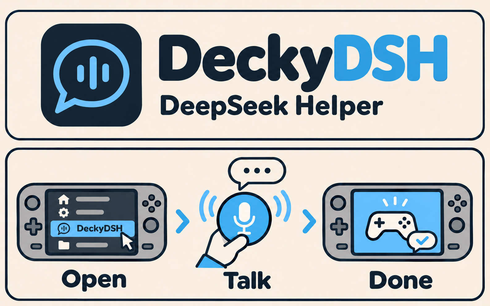

# DeckyDSH

English | [简体中文](README.zh-CN.md) | [繁體中文](README.zh-TW.md)



[](https://github.com/Qiming-Liu/DeckyDSH/releases/latest)

A [Decky Loader](https://github.com/SteamDeckHomebrew/decky-loader) plugin that runs the
[DeepSeek Harness](https://github.com/deepseek-ai/deepseek-harness) (`dsh`) agent on
SteamOS handhelds, from the Quick Access menu. Talk to it with the controller, without
Desktop Mode.

## Installation

Download **DeckyDSH.&lt;version&gt;.zip** from the [latest release](https://github.com/Qiming-Liu/DeckyDSH/releases/latest)
and install it through Decky Loader's developer settings. Use the plugin ZIP,
not GitHub's **Source code (zip)**.

You need a [DeepSeek API key](https://platform.deepseek.com/api_keys). dsh brings no
model of its own: it uses your key, and you pay DeepSeek for what you use.

## First-time setup

Open **DeckyDSH** in the Quick Access menu and choose **Start setup**. It takes about
five minutes, mostly downloading:

1. **Check device**: the CPU and system libraries the runtime needs.
2. **Download runtime**: the official single-file `dsh`, with its own Node.js. It goes
   in the plugin's data folder: no `sudo`, no system changes, and your own `~/.dsh` is
   left alone. The download is checked against a pinned SHA-256 and resumes where it
   stopped.
3. **API key**: checked against DeepSeek and stored on this device only.
4. **Safety**: how new chats approve the commands dsh wants to run, and the workspace
   folder (`~/DeckyDSH` by default).

## Using the plugin

The Quick Access panel is a chat with dsh.

- **Talk**: press **X**, speak, press **X** again. Speech recognition runs on the
  device (SenseVoice Small, about 266 MB, downloaded once in **Settings**). Recordings
  are never uploaded and are deleted once transcribed. Prefer typing? Turn on
  **Show text input** in Settings.
- **Approve**: with **Manual approval**, dsh asks before risky commands and can only
  write files in the workspace. **X** allows once, **Y** rejects. **Skip all
  approvals** runs every command without asking; each chat can switch.
- **Chats**: **Y** starts a new chat or stops a running one. The chat menu lists earlier
  chats and can rename, star, archive or delete them. Files can be attached to a message.
- **Settings**: input, approval default, API key and runtime. The **About** tab has the
  version, a feedback QR code, recommended plugins and the plugin's log (export it and
  attach the file when reporting a problem).

## Important notes

- DeepSeek Harness is experimental and has not had a security audit. Commands the AI
  writes can change or delete files and send data over the network. Read its
  [safety notice](https://github.com/deepseek-ai/deepseek-harness/blob/master/SAFETY.md)
  and back up your saves first.
- Session logs are never uploaded to DeepSeek. The plugin's own log removes home
  directories, API keys and other secrets.

## Special thanks

- [DeepSeek Harness](https://github.com/deepseek-ai/deepseek-harness) by deepseek-ai.

## Development

```sh
git submodule update --init
pnpm install
pnpm run typecheck
pnpm test
pnpm run build
```

Backend tests need no Decky runtime; run them with CPython 3.14, Decky's bundled
interpreter. `pnpm run runtime:manifest` refreshes `runtime/manifest.json` for the
version pinned by the `dsh/` submodule.
