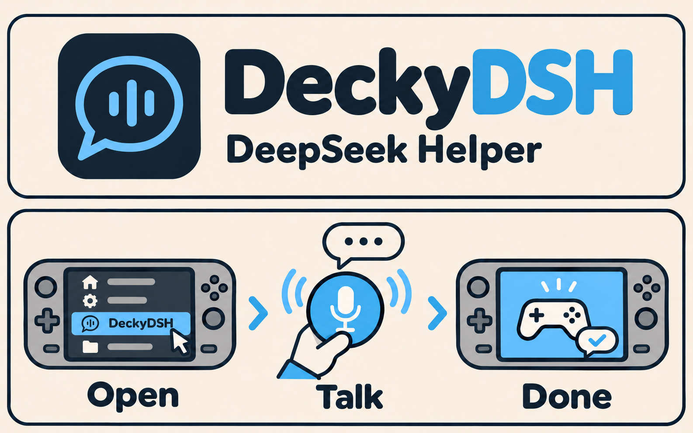

# DeckyDSH

[English](README.md) | 简体中文 | [繁體中文](README.zh-TW.md)



[](https://github.com/Qiming-Liu/DeckyDSH/releases/latest)

一款 [Decky Loader](https://github.com/SteamDeckHomebrew/decky-loader) 插件，在 SteamOS 掌机的快速访问菜单里运行
[DeepSeek Harness](https://github.com/deepseek-ai/deepseek-harness)（`dsh`）智能体。用手柄直接和它对话，不用切到桌面模式。

## 安装

从[最新版本](https://github.com/Qiming-Liu/DeckyDSH/releases/latest)下载 **DeckyDSH.&lt;版本号&gt;.zip**，
在 Decky Loader 的开发者设置里安装。请用插件 ZIP，不要用 GitHub 自动生成的 **Source code (zip)**。

你需要一个 [DeepSeek API Key](https://platform.deepseek.com/api_keys)。dsh 本身不带模型，用的是你的 Key，费用由 DeepSeek 按用量收取。

## 首次设置

在快速访问菜单里打开 **DeckyDSH**，选 **开始安装**。大约 5 分钟，主要时间花在下载上：

1. **检查设备**：确认 CPU 和系统库满足运行时的要求。
2. **下载运行时**：官方的单文件 `dsh`，自带 Node.js。放在插件的数据目录里：不需要 `sudo`，不改系统，也不碰你自己的 `~/.dsh`。
   下载后会按固定的 SHA-256 校验，中断后能从断点继续。
3. **API Key**：会先向 DeepSeek 验证，只保存在这台设备上。
4. **安全设置**：新对话里 dsh 要执行命令时怎么审批，以及工作目录（默认 `~/DeckyDSH`）。

## 使用

快速访问面板就是和 dsh 的对话。

- **说话**：按 **X**，说完再按 **X**。语音识别在本机运行（SenseVoice Small，约 266 MB，在 **设置** 里下载一次）。
  录音不会上传，识别完就删除。想打字的话，在设置里打开 **显示文字输入框**。
- **审批**：选 **手动审批** 时，dsh 执行有风险的命令前会先问你，而且只能在工作目录里写文件。**X** 允许一次，**Y** 拒绝。
  **跳过所有审批** 会直接执行所有命令，不再询问；每个对话都可以单独切换。
- **对话**：**Y** 新建对话，或停止正在运行的对话。对话菜单里能看到以前的对话，可以重命名、加星标、归档或删除。消息可以附带文件。
- **设置**：输入方式、默认审批方式、API Key 和运行时。**关于** 页有版本号、反馈二维码、推荐插件和插件日志
  （反馈问题时导出日志，把文件附上）。

## 注意事项

- DeepSeek Harness 还是实验性软件，没有经过安全审计。AI 写的命令可能修改或删除文件，也可能通过网络发出数据。
  使用前请先看它的[安全说明](https://github.com/deepseek-ai/deepseek-harness/blob/master/SAFETY.md)，并备份好存档。
- 会话日志从不上传给 DeepSeek。插件自己的日志会去掉用户目录、API Key 和其他敏感信息。

## 特别感谢

- deepseek-ai 的 [DeepSeek Harness](https://github.com/deepseek-ai/deepseek-harness)。

## 开发

```sh
git submodule update --init
pnpm install
pnpm run typecheck
pnpm test
pnpm run build
```

后端测试不需要 Decky 运行环境，用 CPython 3.14（Decky 自带的解释器版本）运行。
`pnpm run runtime:manifest` 会按 `dsh/` 子模块固定的版本更新 `runtime/manifest.json`。
