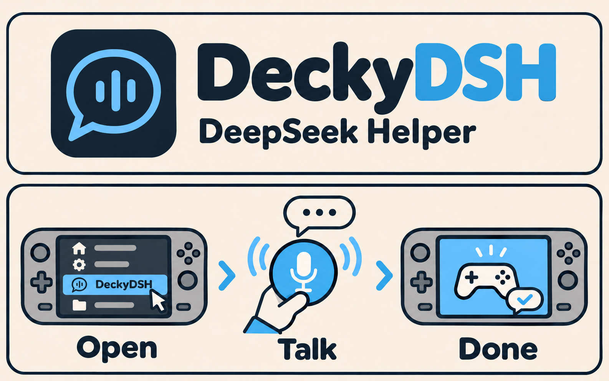

# DeckyDSH

[English](README.md) | [简体中文](README.zh-CN.md) | 繁體中文



[](https://github.com/Qiming-Liu/DeckyDSH/releases/latest)

一款 [Decky Loader](https://github.com/SteamDeckHomebrew/decky-loader) 外掛，在 SteamOS 掌機的快速存取選單裡執行
[DeepSeek Harness](https://github.com/deepseek-ai/deepseek-harness)（`dsh`）智慧代理。用手把直接和它對話，不必切換到桌面模式。

## 安裝

從[最新版本](https://github.com/Qiming-Liu/DeckyDSH/releases/latest)下載 **DeckyDSH.&lt;版本號&gt;.zip**，
在 Decky Loader 的開發者設定裡安裝。請使用外掛 ZIP，不要用 GitHub 自動產生的 **Source code (zip)**。

你需要一組 [DeepSeek API Key](https://platform.deepseek.com/api_keys)。dsh 本身不帶模型，使用的是你的 Key，費用由 DeepSeek 依用量收取。

## 首次設定

在快速存取選單裡開啟 **DeckyDSH**，選擇 **開始安裝**。大約 5 分鐘，主要時間花在下載上：

1. **檢查裝置**：確認 CPU 和系統函式庫符合執行環境的要求。
2. **下載執行環境**：官方的單檔 `dsh`，內建 Node.js。放在外掛的資料資料夾裡：不需要 `sudo`，不改動系統，也不碰你自己的 `~/.dsh`。
   下載後會依固定的 SHA-256 驗證，中斷後可以從中斷處繼續。
3. **API Key**：會先向 DeepSeek 驗證，只儲存在這台裝置上。
4. **安全設定**：新對話裡 dsh 要執行指令時如何審批，以及工作資料夾（預設 `~/DeckyDSH`）。

## 使用

快速存取面板就是和 dsh 的對話。

- **說話**：按 **X**，說完再按 **X**。語音辨識在本機執行（SenseVoice Small，約 266 MB，在 **設定** 裡下載一次）。
  錄音不會上傳，辨識完就刪除。想打字的話，在設定裡開啟 **顯示文字輸入框**。
- **審批**：選擇 **手動審批** 時，dsh 執行有風險的指令前會先詢問你，而且只能在工作資料夾裡寫入檔案。**X** 允許一次，**Y** 拒絕。
  **跳過所有審批** 會直接執行所有指令，不再詢問；每個對話都可以個別切換。
- **對話**：**Y** 開新對話，或停止執行中的對話。對話選單裡能看到之前的對話，可以重新命名、加星號、封存或刪除。訊息可以附加檔案。
- **設定**：輸入方式、預設審批方式、API Key 和執行環境。**關於** 頁有版本號、回報 QR Code、推薦外掛和外掛紀錄
  （回報問題時匯出紀錄，把檔案附上）。

## 注意事項

- DeepSeek Harness 仍是實驗性軟體，沒有經過安全稽核。AI 寫的指令可能修改或刪除檔案，也可能透過網路送出資料。
  使用前請先閱讀它的[安全說明](https://github.com/deepseek-ai/deepseek-harness/blob/master/SAFETY.md)，並備份好存檔。
- 工作階段紀錄從不上傳給 DeepSeek。外掛自己的紀錄會移除使用者目錄、API Key 和其他敏感資訊。

## 特別感謝

- deepseek-ai 的 [DeepSeek Harness](https://github.com/deepseek-ai/deepseek-harness)。

## 開發

```sh
git submodule update --init
pnpm install
pnpm run typecheck
pnpm test
pnpm run build
```

後端測試不需要 Decky 執行環境，用 CPython 3.14（Decky 內建的直譯器版本）執行。
`pnpm run runtime:manifest` 會依 `dsh/` 子模組固定的版本更新 `runtime/manifest.json`。
